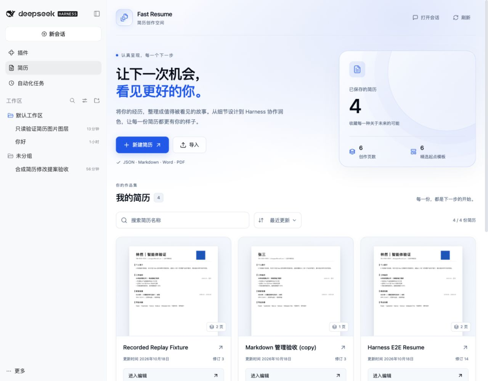
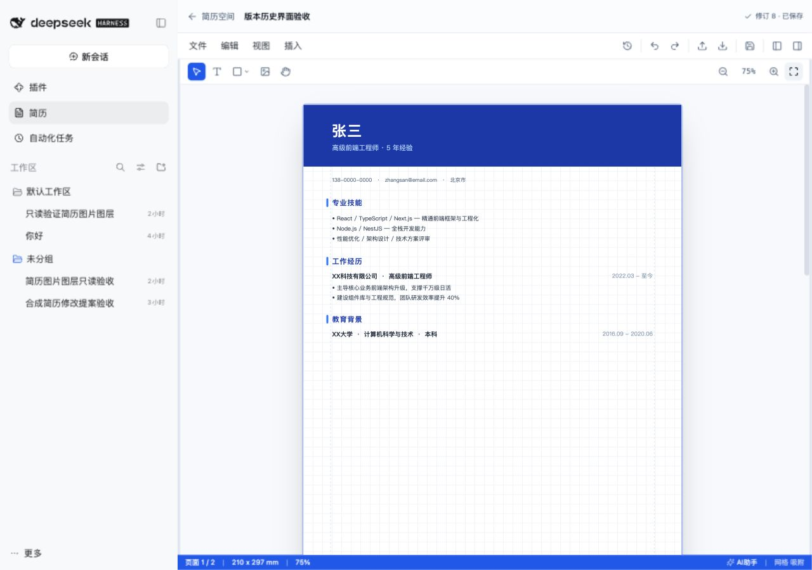
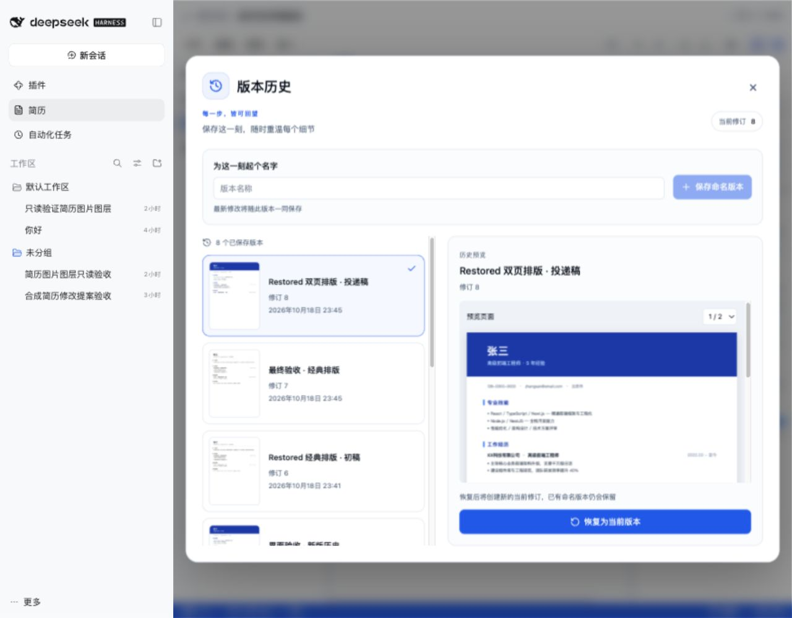
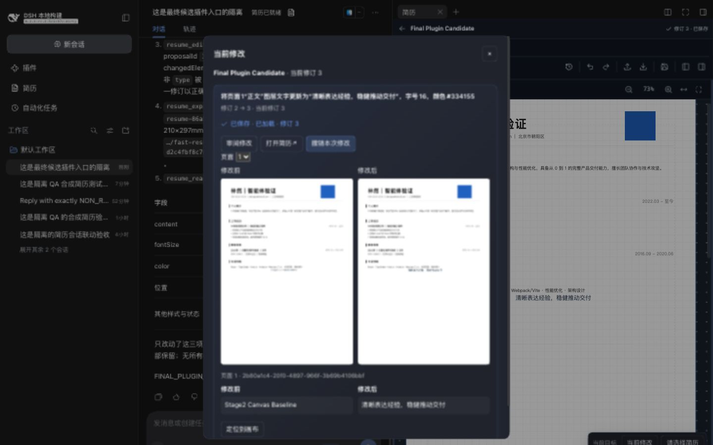

# Fast Resume for DeepSeek Harness

English | [中文](README.zh.md)

## Summary

Create, manage and refine your resumes inside DeepSeek Harness. Edit text, images, shapes and nested layers on a multipage canvas, choose from six templates, and export PDF, PNG or editable JSON. Use your existing Harness model to propose wording and layout improvements, review the changes, and apply them to the same document. Install `dsh-fast-resume` as an optional profile layer; no separate Fast Resume account is required.



## Table of Contents

- [Features](#features)
- [Screenshots](#screenshots)
- [Installation](#use-this-package)
- [Usage examples](#usage)
- [Configuration and storage](#configuration-and-storage)
- [Development](#understand-the-implementation)
- [Model Experience](#model-experience)
- [Limitations and license](#known-limitations-and-deferred-work)

-----

<a id="features"></a>
## Features

Keep visual editing and agent assistance in one workflow.

| Capability | What you can do |
|---|---|
| Canvas editing | Edit text, images and shapes; group nested layers; control order, visibility, locks, alignment and element properties. |
| Templates and pages | Start with six templates, manage multiple pages, zoom the canvas, and resize or collapse either sidebar. |
| Resume management | Browse real first-page thumbnails; search, sort, rename, duplicate and delete resumes. |
| Version history | Save named versions, preview historical pages and restore a version as a new revision. |
| Harness assistance | Send the current resume and selected-layer context to a normal Harness conversation; review, apply or revert durable proposals. |
| Import and export | Import JSON, Markdown, Word or PDF; export all pages to PDF, the selected page to PNG, or an editable JSON backup. |

-----

<a id="screenshots"></a>
## Screenshots

These screenshots show the installed Harness Web plugin with synthetic resumes used for verification.

### Canvas editor

Collapse the sidebars for more canvas space, or reopen them from the right-hand toolbar to work with templates, layers and properties. Dragging past the minimum threshold also collapses a sidebar.



### Visual version history

Identify versions by their actual saved-page thumbnails. Select a version, switch preview pages and restore it without replacing the existing history.



### Conversation and change review

Review before/after pages beside the full editor in a Harness conversation. This synthetic example shows an applied text/style change at revision 3, acknowledged as saved and loaded by the conversation editor.



-----

<a id="use-this-package"></a>
## Installation

Use **DeepSeek Harness 0.2.1-rc.2**, Node **`^22.19.0 || >=24.0.0`**, and pnpm available on PATH. The plugin version in this repository is `0.1.0`.

This integration candidate is not approved for publication. Its package and browser-module consumer checks target the published `0.2.1-rc.2` dependencies; Session replay and Web verification use locally built Harness artifacts with that version. These results do not establish support for every interaction in the published Harness release. Local integration acceptance covers the tested artifact and declared browser cases; publication still requires a supporting tested Harness distribution and explicit approval.

Obtain a built `.tgz` package, or generate one with the [source-build steps](#understand-the-implementation). Install it into the profile you use:

```sh
dsh plugin --profile web add /absolute/path/dsh-fast-resume-0.1.0.tgz
dsh --profile web
```

Open **Resumes / 简历** in the Harness sidebar. The workspace displays your saved resumes and the create/import actions.

If `dsh-fast-resume@0.1.0` has been published to your registry, you can install by package name instead:

```sh
dsh plugin --profile web add dsh-fast-resume@0.1.0
```

For an initialized Desktop profile, replace `web` with `desktop` and restart the application. The recorded browser verification covers Web; Desktop interaction is not claimed as verified.

-----

<a id="usage"></a>
## Usage examples

### 1. Create and edit a resume

1. Choose **New resume / 新建简历**, enter a name, and select a template preview or blank document. Open a saved resume by clicking its name or **Open editor**.
2. Use the left panel to switch templates, inspect layers and manage pages. Select an element and edit its text, dimensions, colors or links in the properties panel.
3. Drag either divider to resize the workspace. Use the toolbar panel icons to collapse or reopen the sidebars; the mounted workspace remembers their expanded widths.
4. Wait for the saved indicator, or use the save icon / `Ctrl+S`.

The editor initially fills the available canvas width; long pages scroll vertically. Toolbar zoom preserves the viewport center, and wheel zoom preserves the pointer position. Larger zoom levels allow horizontal scrolling. Fit width and Fit to window return to automatic width or whole-page fitting, while manual zoom stays unchanged when panels resize.

### 2. Refine it with your Harness agent

Open **Harness assistant / Harness 助手** from the editor status bar, View menu, or `Ctrl/Cmd+J`. The global editor saves and checkpoints the resume, resolves your selected or default Workspace and creates one ordinary Harness conversation with your configured default model policy, and transfers the full editor into its right pane. The central input waits for your instruction; entry sends no prompt. Inside a conversation, these actions reveal its selected resume without creating another conversation. Return through the global resume space to explicitly start a new conversation, or use the Harness conversation list to continue an older one.

New foreground resume context or successful edit activity in an ordinary conversation can open its selected resume without changing the Session or model. History, reconnects and background completions remain passive. Closing or choosing another resource suppresses the rest of that turn; an older result cannot override a newer successful target choice. Below 768px, use **Open resume** explicitly. **Saved · view pending** reports the durable result; **Saved · loaded** requires the visible editor to acknowledge that exact clean revision after rendering. Acknowledging the current saved revision refreshes its loaded evidence after rendering. View errors retain saved status and the explicit viewing action.

Open a resume tool card’s **Current changes**, then **Review changes** to compare immutable before/after pages and values. **Apply proposal** explicitly approves a nonmutating proposal; **Undo this change** reverses one applied batch while retaining later unrelated edits. Overlapping edits keep the current document and show a conflict. The editor’s compact **Current changes** control provides the same review and Undo actions. Unknown outcomes keep **Check outcome** on the original action; reloading reconciles durable application and Undo receipts. Newer durable Undo receipts supersede retained Apply receipts; earlier saved revisions remain distinct from the currently loaded revision.

Use **Choose a resume** in the conversation editor or on a missing-target card. **Compare** opens a document without retargeting the conversation; **Use for editing** explicitly selects it. The editor marks comparison views, and acknowledged manual saves, imports and draft copies select their editing target. **Resume space** still opens the global library. Fresh acknowledged changes receive local 1.2-second outlines; historical cards do not animate or navigate. **Locate on canvas** explicitly navigates to a surviving changed element or page; deleted content stays in the comparison preview.

Example: improve wording while preserving facts.

> Read this resume and improve the work-experience wording for a frontend engineering role. Preserve the facts, dates and figures. Do not invent achievements or skills. Create a proposal first; do not apply it until I have reviewed it.

Review proposed changes in the conversation before asking the assistant to apply them. `resume_propose` does not mutate the resume. Applying or reverting a proposal checks its revision and overlapping edits; conflicts preserve the current document.

### 3. Save a milestone and compare versions

Open the history icon, enter a version name such as “Frontend application”, and save a named version. Select a thumbnail to inspect that snapshot; use the page selector for multipage resumes. Restore only after the current draft is saved. Restoring creates a new revision and retains existing versions.

### 4. Import or export your document

Use **Import / 导入** for an existing JSON backup, Markdown, Word or PDF. Choose PDF for a document containing all pages, PNG for the selected page, or JSON to keep an editable backup. PDF/Word imports extract semantic content; they do not promise the original layout. PDF/PNG export requires a connected Harness client renderer.

Use the file drop zone or paste Markdown in the import dialog. The dialog stays open while a file is being read or imported, and reports validation or import failures in place.

-----

<a id="configuration-and-storage"></a>
## Configuration and storage

Resume files, history, proposals and exports stay in the active profile, under `<profile>/data/fast-resume` by default. Autosave uses revision checks; when another client or agent changes the same resume, a dirty draft is retained with reload and save-as-copy choices. Draft recovery requires an explicit choice.

<details>
<summary>Advanced configuration</summary>

The installed [patch](cordis.patch.yml) contributes `fast-resume` and `fast-resume-tools`. Override the Host row in your profile's `cordis.patch.yml`:

```yaml
- id: fast-resume
  config:
    autosaveDelayMs: 2000
    renderPixelRatio: 2
```

| Field | Default | Meaning |
|---|---|---|
| `wheelZoomDirection` | `auto` | Ctrl/⌘ + wheel zoom: `auto` honors browser device-inversion metadata, `standard` follows raw wheel deltas, and `reversed` flips them for devices that feel backwards. Plain wheel scrolling is unchanged. Explicit reversal also reverses trackpad pinch events delivered as Ctrl+wheel; use `auto` for native pinch behavior. |
| `storageDir` | `<profile>/data/fast-resume` | Atomic document envelopes, history, proposals, receipts and exports |
| `autosaveDelayMs` | `2000` | Browser save debounce |
| `maxDocumentBytes` / `maxImportBytes` | `10485760` each | Document/render response and imported file byte bounds |
| `maxAssistantCheckpointBytes` | `67108864` | Normalized UTF-8 editor checkpoint limit, including undo/redo and clipboard |
| `maxVersions` | `100` | Retained document versions |
| `renderTimeoutMs` / `rendererLeaseMs` | `30000` / `15000` | Render deadline and renewable connected-client lease |
| `maxRenderRequests` / `maxRenderPixels` | `8` / `32000000` | Pending render requests and decoded PNG pixels |
| `renderPixelRatio` | `2` | PNG raster multiplier; allowed range `0.1`–`4` |
| `editorPrepareTimeoutMs` / `editorLeaseMs` / `editorPollIntervalMs` | `15000` / `15000` / `1000` | Draft preparation deadline, editor liveness budget and polling; polling must be shorter than the lease |
| `lockWaitMs` / `maxProposalOperations` | `10000` / `256` | Cross-process lock wait and operations per proposal |
| `frameConnectTimeoutMs` / `rendererPollIntervalMs` | `15000` / `1000` | Editor connection deadline and renderer polling; polling must be shorter than the lease |
| `refreshIntervalMs` / `bridgeTimeoutMs` | `2000` / render plus connection deadlines | Document refresh and message deadline; messages must allow the full export deadline |

</details>

To remove the plugin:

```sh
dsh plugin --profile web remove dsh-fast-resume
```

Uninstalling retains the profile-local resume files and exports. Reinstall into the same profile to use them again.

-----

<a id="understand-the-implementation"></a>
## Development

The source project builds independently of the original Fast Resume and Harness checkouts. From the plugin project root:

```sh
npm ci --workspaces=false
npm run build --workspaces=false
npm pack --workspaces=false --ignore-scripts
```

The result is `dsh-fast-resume-0.1.0.tgz`. Test that tarball through `dsh plugin` before publishing. The package includes the Host, tools, Client, editor HTML, installation patch and documentation.

The installed acceptance checks use an actual temporary tarball installation, without source aliases. Set `DSH_TEST_CLI` to the built public `apps/cli/lib/bin.js` entry and `DSH_TEST_REPLAY` to `packages/test-support/llm-replay/lib/index.js` from the same tested Harness build, then run:

```sh
npm test --workspaces=false
npm run build --workspaces=false
node scripts/check-consumer.mjs
npm run check:release --workspaces=false
npm pack --workspaces=false --ignore-scripts
npm run test:e2e --workspaces=false -- ./dsh-fast-resume-0.1.0.tgz
npm run test:snapshot --workspaces=false -- ./dsh-fast-resume-0.1.0.tgz
```

The scripted check covers installation, retained data after uninstall/reinstall, disabled tools, both seeded entry contexts and selective undo. The snapshot check preserves the image-redaction read and replays curated real-model turns. Replay preserves the actual Session identity and binding but omits the Web preset from its temporary headless initialization, because headless cannot compose that preset. This checks installed tool behavior, not full Web Session continuation. Neither check contacts a model provider or substitutes for browser verification. Temporary profiles are removed after child processes exit; set `DSH_TEST_KEEP=1` to retain local evidence. Missing entry paths fail the check.

Detailed business outcomes, replay adaptations and unexecuted checks are recorded in the AI assistant acceptance report ([English](docs/assistant-acceptance.md) / [中文](docs/assistant-acceptance.zh.md)).

### Local Harness development

With Node and pnpm on PATH, `npm run dev:setup --workspaces=false` builds both compiler faces and installs a `link:` dependency through `dsh plugin` into `.dev/home/profiles/web`. Inside a Harness checkout, build Harness first with `pnpm run build:artifacts`; the helper uses `apps/cli/lib/bin.js`. Elsewhere it uses `dsh` on PATH, or the launcher file supplied through `DSH_DEV_CLI`.

```sh
npm run dev:setup --workspaces=false
npm run dev --workspaces=false
```

Open the authenticated URL printed by Harness (default port `58358`), then open Resume space. The helper watches source, upstream code, locales and build configuration, stops Web before rebuilding, and restarts it after both compiler faces pass. A failed rebuild leaves Web stopped until you fix and save the source. Save your editor changes before editing code; interrupted drafts use the normal recovery flow. Ctrl+C stops the watcher and its child processes. Use `npm run dev:start --workspaces=false` for a build and launch without watching; Web flags follow `--`, for example `npm run dev --workspaces=false -- --port 58359`.

`.dev/` is Git-ignored and holds development profiles, resumes and local configuration. Configure a model in this development Web UI to test agent assistance; no credentials are copied from other profiles. Set `DSH_HOME` explicitly to use another home. A fresh enclosing Harness clone initializes this checkout with `git submodule update --init --recursive plugins/fast-resume`. Commit and push plugin edits from this directory, then stage the updated submodule revision in Harness.

<details>
<summary>Implementation overview</summary>

The [installation patch](cordis.patch.yml) adds `fast-resume` and `fast-resume-tools`. The Host owns revisions, atomic file writes, durable proposals and mutation receipts. The editor runs in an opaque-origin iframe and communicates through a validated MessagePort; it does not hold model credentials or call the original Fast Resume server. Retained upstream source and its hashes are recorded in [upstream-content.json](upstream-content.json).

</details>

-----

<a id="model-experience"></a>
## Model Experience

Resume tools run in the normal Agent scope, and their requests/results remain in the Harness Session log. The agent can read the current document, propose changes, apply or revert proposals, inspect history and export artifacts. Image reads use asset references; export results include artifact paths and metadata instead of inline base64 data.

`resume_context` resolves the invoking Session’s target or explicitly selects a document using its last-read revision and a unique request ID. Comparison reads do not change the selection. Missing or deleted targets require a choice; existing document `sessionId` fields do not create bindings. Identical selection retries return their original result without replacing a later selection; changed inputs with the same request ID fail. Selection never changes document JSON, revisions, or history.

`resume_edit` commits a validated operation batch, one revision, an applied proposal and its undo receipt in one document-file replacement. Its output is `{ schemaVersion: 1, resumeId, sessionId, baseRevision, receipt, summary }`. Identical retries recover the original receipt before checking editor availability; changed inputs with the same request ID reject. `resume_propose` stays nonmutating. Model apply/revert/restore also prepare known editors and retain their existing receipt outputs. Successful model mutations associate the target with the invoking Session after releasing document locks; an association failure reports the committed receipt rather than a rollback.

Authenticated UI approval and Undo use `uiMutation`, the same editor preparation, Session serialization and receipt recovery as model mutations. Its result separates the committed receipt from target association (`bound`, `superseded`, `ambiguous`, `failed`) and editor release (`released`, `uncertain`, `not-required` for recovered receipts). `ResumeActions` retains the original request after transport uncertainty, fences inactive Sessions and drains cancelled operations before Remote teardown. Conversation-frame saves use `saveInSession` with the current editor capability and a separate `contextSessionId`; they capture selection ordering before saving and associate afterward only if that selection remains current. An association failure retains the saved snapshot and is exposed through `EditorApi.association()` separately from save errors. Global saves and comparison reads remain nonbinding.

The Host owns accepted conversation saves, context/handoff requests, editor ownership requests and model/UI mutations through their final result and durable association. Provider unload and enclosing-context disposal reject fresh admission and cancel preadmission model preparation, then await accepted writes and completion callbacks. Polling, preparation acknowledgement and disconnect persistence remain usable during this drain; all three reject after settlement. Cleanup failures are reported only after the other cleanup owners and accepted operations settle. Manual draft saves remain outside the model Session execution lock.

The global editor stays editable during model generation. Before committing, the Host requests preparation: the frame fences gestures, drains in-flight saves and local recovery writes, flushes, and acknowledges the clean revision. A flush that changes the model's base revision rejects the AI edit; read again and use a new request ID. Unknown, disconnected, expired, restarted, or recovery-pending owners block only AI writes to that document. Open the document and explicitly acknowledge its displayed committed revision to reconcile ownership; recovery copies remain available. Manual recovery remains usable. Acknowledgement waits for outstanding polling failures to finish before clearing ownership uncertainty. Startup ownership rejection offers explicit recovery; missing documents and read failures offer localized retry and Resume space navigation.

A contiguous committed assistant revision installs as one manual undo entry, clears redo, and keeps selections whose elements remain present. Repeated acknowledgement does not add history or trigger autosave. Active text input, composition and pointer gestures defer incoming updates without interrupting the edit. A local draft, revision gap, or missing change receipt retains the current document and history, with actions to reload the saved revision or save a copy.

Explicit editor handoffs use `prepareEditorHandoff`, `completeEditorHandoff` and `rollbackEditorHandoff` in `src/client/editor-handoff.ts`. Callers preallocate the destination generation and pass its identity and `EditorLaunch` to `connectFrame`. After preparation, `releaseEditorHandoff` returns a serializable descriptor to journal before disposing the source view and navigating. Completion needs no source VM. Detached failures return `EditorHandoffRecoveryError.handoff`; `recoverEditorHandoff` durably revokes the previous target and designates a fresh recovery frame using the same retained history. Retry unknown recovery outcomes with the same fresh identity, then mount and complete that frame. Launch carries the actual optional Session context independently of document association. Preparation drains saves and recovery, fences gestures, and captures full history plus the real canvas scroll/center anchor. Composition and active pointer gestures reject without interruption. The target restores the exact revision and acknowledges committed layout before becoming writable. Manual zoom keeps its document center and horizontal overflow; width/page fit recomputes for the target canvas. Explicit checkpoint restoration cancels ordinary queued zoom anchors so they cannot move the viewport after loaded acknowledgement. Checkpoints retain the original panel preferences. Conversation placement collapses internal panels in the target iframe only; tool, panel tabs, dimensions, history, selection and manual zoom remain intact. The persisted checkpoint remains suitable for global recovery. Fullscreen uses the existing tab body.

`editorTransferRead` is an authenticated, nonmutating lookup by exact resume, transfer and checkpoint IDs. It returns only disposition and revisions. A confirmed active transfer with available empty tab storage is already consumed; an active matching journal becomes obsolete when the saved document advances beyond its checkpoint. Cleanup checks the unchanged journal generation. Incoming descriptors remain available to Retry until durably journaled or positively consumed. Active same-revision journals retain lost-activation ambiguity and require explicit recovery; pending, unknown, failed reads and newer journals remain protected. Successful completion or consumed reconciliation removes only the matching incoming navigation parameters through public tab actions, preserving the live iframe and history. Reopening then uses ordinary current-document acquisition and explicit ownership recovery when required.

A Session header’s **Open resume** action resolves that Session’s current target through the authenticated, nonbinding `readContext` API. Its post-commit effect checks the mounted Session again before opening `dsh-resource://fast-resume/document/<id>`. The public right-tab registry retains the full editor through hiding, Session changes and fullscreen. Mounted hidden views renew their existing ownership lease while pausing canvas refresh, model preparation and CSS motion; hidden geometry cannot acknowledge a checkpoint. Library navigation returns to the global page, and import/copy replaces the resource address through public tab navigation. A `sessionStorage` journal retains transfer descriptors and recovery designations across reloads in the same browser tab; retry explicitly recovers a failed detached target. Each journal write carries a fresh generation; delayed attempts may replace or remove only the exact record they own. Denied tab storage preserves ordinary editor startup and its ephemeral-owner warning, but transfer requires a confirmed journal write before the source closes. Clearing browser-tab storage removes that discovery descriptor, while the Host checkpoint and recovery copies remain retained.

One private `storageDir/transfers-v1/<resumeId>.json` record retains each document’s recovery checkpoint. Version one stores source owner/token/incarnation, designated target owner/incarnation/token, transfer/checkpoint IDs, revision, checkpoint JSON, rollback token, optional `recoveryTarget` marker and phase (`prepared`, `claimed`, `active`, `revoking`, `rolledback`). Retention and ownership are separate atomic files, written under admission then document locking; no multi-file transaction is claimed. Pending records fence browser writes and model admission, reject replacement and duplicate claims, and are never silently evicted. A completed record may be replaced only by the verified current owner. Rollback revokes the target before issuing the retained source a fresh token; response loss never implies target absence. If a later transfer fails before replacing a completed record, rollback reconfirms the unchanged source token/incarnation under the same locks; uncertain ownership or another pending transfer still rejects. External tokenless CAS remains supported, and a changed revision rejects restore/rollback visibly while retaining history. ResumeEnvelope, ChangeReceipt, Session context and Harness Session formats are unchanged.

Editor ownership persists separately at `storageDir/owners-v1/<resumeId>.json`. Version-one records contain `schemaVersion`, `hostId`, `resumeId`, `ownerId`, `incarnationId`, `token`, `uncertain`, `seenAt`, optional `detached` disposal evidence, permanently `retired` incarnations and optional `preparation` (`id`, `expectedRevision`, `deadline`, `phase`, optional acknowledged `revision`). Record and document replacement are individually atomic, not a two-file transaction. Admission serializes preparation/commit and owner replacement; owner replacement takes admission then the document writer lock. Poll/ack/save take only the document lock, and token validation occurs inside that lock immediately before mutation. Session binding uses context then document locking, outside model commit locks. Corrupt records fail visibly. Leases never erase uncertainty. A different Host instance requires explicit reconciliation of an existing owner. Independent browser acquisition never replaces an existing writer. Explicit recovery rejects a recent live generation; for a disposed, expired or restarted owner it revokes the old token but remains uncertain until the saved revision is acknowledged. Expiry alone never grants ownership. `detached` is set only by explicit frame disposal, not a failed live preparation.

Current packaged editor mutations always supply a branded document token; revoked tokens reject, including delayed writes from retired frames. External manual calls that omit the optional token retain optimistic CAS semantics. Drafts in undiscovered legacy/device editors cannot be fully observed. `ResumeEnvelope.schemaVersion = 1`, existing `ChangeReceipt` fields and Harness Session formats are unchanged; older plugin versions ignore the ownership directory and do not provide these draft-coordination guarantees.

Pending model associations use one bounded `storageDir/context-commits-v1/<sha256(SessionId)>.json` record per Session, independent of existing `contexts-v1` records. Version-one intent fields are `schemaVersion`, `sessionId`, `resumeId`, stable hashed mutation `requestId`, full-input `fingerprint`, and `previousBinding` (the preceding durable selection request ID or null). Per-Session execution locks use `lockWaitMs` and span mutation outcome/intent settlement; short context operations and document locks follow inside execution ownership, never acquired from a held document lock. Repair uses selection identities, not timestamps, and permits the document revision to advance. A later explicit selection supersedes repair. A different unresolved intent rejects; identical retries remain repairable after restart. Confirmed pre-commit rejections clear only their captured intent after verifying no receipt; unknown storage outcomes retain it. Context write and intent cleanup are separate atomic operations; a persisted binding receipt makes incomplete cleanup idempotent. Historical receipts without ordering evidence preserve the current selection and report association ambiguity. Document, `ChangeReceipt`, `ResumeSessionContextV1` and Harness Session formats are unchanged.

Recovery-write errors are shown separately from save failures. AI preparation waits for backup writes and rejects unresolved recovery errors; an acknowledged manual save still succeeds and runs its cleanup. A successful newer backup or a durable save of that exact draft generation clears the corresponding recovery error. Older completions cannot clear a newer failed backup or draft.

Explicit assistant entries persist under `storageDir/handoffs-v1/<requestId>.json`, separately from resume content. Version-one records contain `schemaVersion`, branded `requestId`, `resumeId`, `expectedRevision`, the chosen `workspaceId`, the allocated `requestedSessionId`, and optional canonical `sessionId`. Workspace selection precedes admission and stays fixed through retries; the public Client Session service creates and publishes the Session with that Workspace. Records without a Workspace retain their evidence but cannot complete entry or create a replacement through Retry. `beginAssistantHandoff` atomically admits creation once; `recordAssistantSession` journals the actual returned identity before `bindAssistantContext`. `readAssistantHandoff` recovers exact evidence. Binding never writes legacy `ResumeEnvelope.sessionId` or increments the resume revision. A known binding failure retries its same Session. An unresolved create only checks the journal and exact requested identity in the Host catalog; if the server returned another identity and its response was lost, the result remains unknown without another create. Check the Harness conversation list. A failed editor mount retains its Session, binding and editor checkpoint for explicit Retry.

The Client stores the active request identity at `sessionStorage['fast-resume:assistant-entry:v1:<resumeId>']` before preparation. All three actions share one pending guard. Save or journal failure creates no Session; pre-navigation failures attempt acknowledged source rollback. The canonical creation response is retained even if the source closes during create. The detached descriptor is retained through `EditorViews.retain` immediately after preparation, before creation or binding waits. A matching rollback acknowledgement alone permits its generation-checked cleanup. After navigation, a null-rendering public `shell.overlay` effect observes the committed right-sidebar Session and opens the exact resource; blank Sessions do not render title actions. The explicit header action remains available when Harness renders it. Revealing the same resource without launch parameters preserves its existing iframe and history. If a source closes, reopen that exact resume in the global space and choose **Recover editor** after its registration is refused. The parent reconnects the same frame with an explicit global launch, the retained descriptor, and a freshly designated recovery generation. It restores the original checkpoint before enabling saves; ordinary browsing does not infer a recent document or acquire its pending ownership. Global recovery keeps the unresolved assistant request; only activation in its canonical conversation clears the matching tab entry, including recovery after reload. Clearing tab storage loses that entry's discovery pointer; it does not erase the Host record or prove creation failed.

Session targets persist under `storageDir/contexts-v1/<sha256(SessionId)>.json`. Each version-one record contains `schemaVersion`, the typed `ResumeSessionContextV1` context, and binding receipts (`requestId`, input fingerprint, context, acknowledged document revision). Contexts contain the actual Session ID, resume ID, UTC update time, and source (`editor-entry`, `explicit-tool`, or `committed-edit`). Writers atomically replace one record while holding the Session and document locks. Readers reject invalid versions, fields, or Session identities visibly; they never guess another target. This plugin-owned format is independent of `ResumeEnvelope` version one and Harness Session events; legacy documents remain unchanged, and versions without this feature ignore the separate directory. Global manual editor workflows require no binding.


-----

<a id="known-limitations-and-deferred-work"></a>
## Limitations and license

- The editor labels are currently Chinese; the Harness integration supports English and Chinese.
- Model-assisted editing uses your Harness model configuration. Review proposals before applying changes to your resume.
- Remote images can fail to load or prevent canvas export; the plugin reports these failures.
- Fast Resume retains **PolyForm Noncommercial 1.0.0**. Commercial use requires separate written permission from the upstream owner. See [LICENSE](LICENSE), [NOTICE](NOTICE) and [commercial licensing terms](COMMERCIAL_LICENSE.md).

For executed checks and platform coverage, read the [verification report](docs/verification.md) ([中文](docs/verification.zh.md)). Source and issue tracking: [lianzxah/dsh-fast-resume](https://github.com/lianzxah/dsh-fast-resume).

<a id="dev-note"></a>
### Dev Note

<details>
<summary>Maintainer context</summary>

Keep screenshots based on synthetic resumes, and update both language versions when workflows change.

</details>
