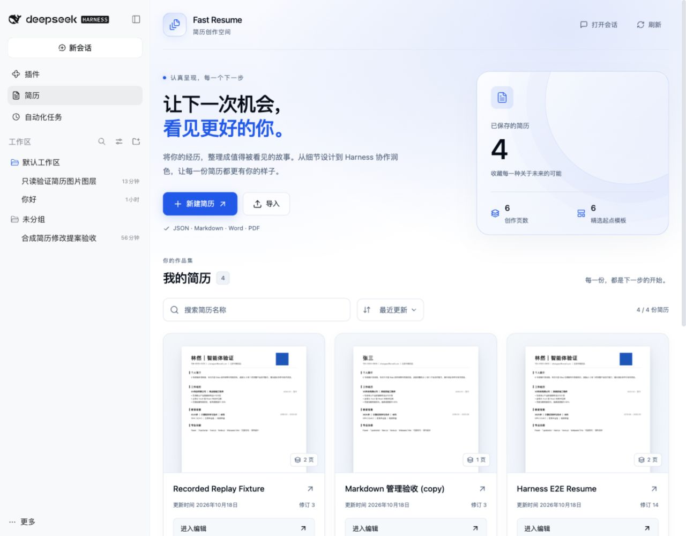
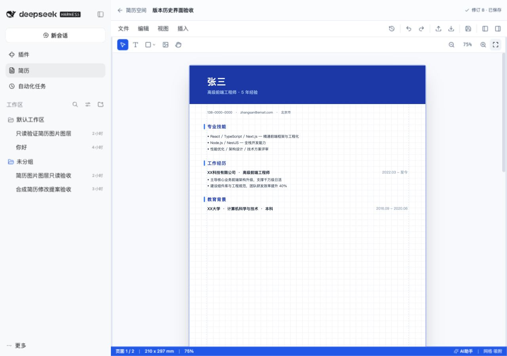
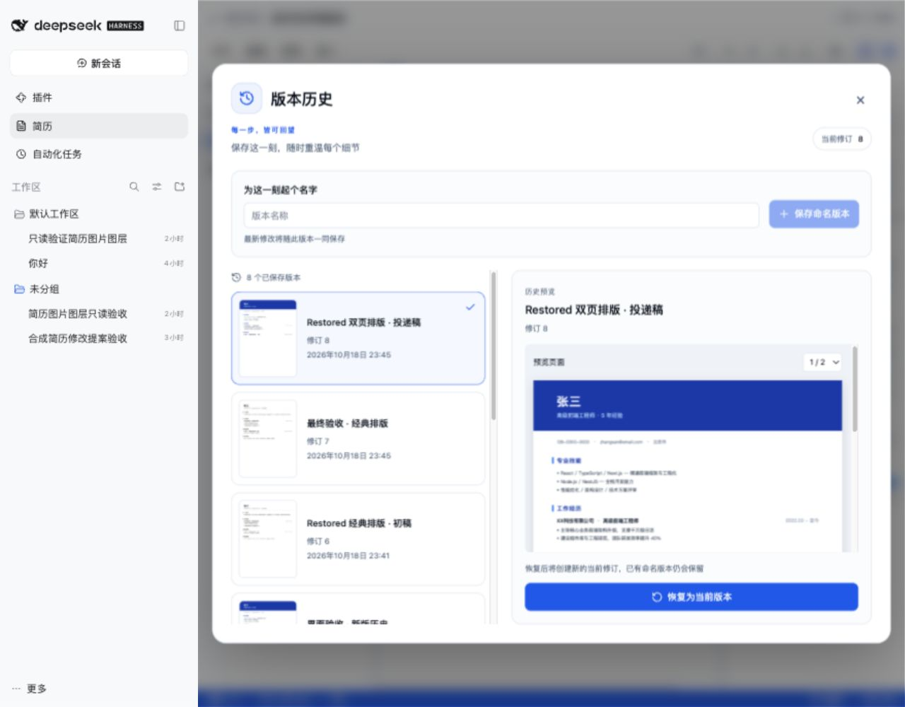

# Fast Resume for DeepSeek Harness

[English](README.md) | 中文

## 项目介绍

在 DeepSeek Harness 内完成简历创建、管理、编辑与智能体优化。通过多页画布自由调整文字、图片、形状和嵌套图层，从六套模板开始创作，并导出 PDF、PNG 或可继续编辑的 JSON。直接使用 Harness 已配置的模型提出措辞或排版修改，预览后应用到同一份简历。`dsh-fast-resume` 作为可选插件配置层安装，无需注册额外的 Fast Resume 账号。



## 目录

- [功能亮点](#features)
- [界面预览](#screenshots)
- [安装插件](#use-this-package)
- [使用方式与实例](#usage)
- [配置与存储](#configuration-and-storage)
- [开发与构建](#understand-the-implementation)
- [智能体交互](#model-experience)
- [使用边界与许可证](#known-limitations-and-deferred-work)

-----

<a id="features"></a>
## 功能亮点

将可视化编辑与智能体辅助放在同一个工作流中。

| 能力 | 可以做什么 |
|---|---|
| 多图层画布 | 编辑文字、图片和形状，组合嵌套图层，调整层级、可见性、锁定、对齐及元素属性。 |
| 模板与页面 | 从六套模板开始，管理多页简历、缩放画布，自由拖拽或收起左右侧栏。 |
| 简历管理 | 浏览真实首页缩略图，按名称搜索、排序、重命名、创建副本及删除简历。 |
| 版本历史 | 保存命名版本，预览历史页面，将选定版本恢复为新的当前修订。 |
| 智能体辅助 | 将当前简历和所选图层上下文带入普通 Harness 对话，预览、应用或撤销持久化修改提案。 |
| 导入与导出 | 导入 JSON、Markdown、Word 或 PDF；将全部页面导出为 PDF、当前页面导出为 PNG，或保存可编辑 JSON 备份。 |

-----

<a id="screenshots"></a>
## 界面预览

以下截图来自实际安装的 Harness Web 插件，使用验证流程中的合成简历展示功能。

### 简历画布

需要更大画布时可收起侧栏，也可通过右侧工具栏重新展开模板、图层和属性面板。拖拽越过最小阈值时，侧栏会自动收起。



### 可视化版本历史

通过真实保存页面的缩略图识别不同版本。选中版本后可切换预览页面，恢复时保留已有历史。



-----

<a id="use-this-package"></a>
## 安装插件

需要 **DeepSeek Harness 0.2.1-rc.2**、Node **`^22.19.0 || >=24.0.0`**，并确保 PATH 中可用 pnpm。当前仓库中的插件版本为 `0.1.0`。

获取已构建的 `.tgz` 安装包，或按[源码构建步骤](#understand-the-implementation)生成安装包，然后安装到实际使用的配置：

```sh
dsh plugin --profile web add /absolute/path/dsh-fast-resume-0.1.0.tgz
dsh --profile web
```

在 Harness 侧栏打开**简历**，即可看到已保存的简历以及新建、导入入口。

如果所用 npm 仓库已发布 `dsh-fast-resume@0.1.0`，也可以直接通过包名安装：

```sh
dsh plugin --profile web add dsh-fast-resume@0.1.0
```

对于已初始化的桌面配置，可将 `web` 替换为 `desktop` 并重启应用。已有浏览器验收覆盖 Web，未声称完成桌面交互验证。

-----

<a id="usage"></a>
## 使用方式与实例

### 1. 创建与编辑简历

1. 点击**新建简历**，输入名称，选择模板或空白文档。
2. 在左侧面板切换模板、查看图层和管理页面；选中元素后，在属性面板调整文字、尺寸、颜色或链接。
3. 拖拽分隔条调整工作区宽度，通过工具栏面板图标收起或展开侧栏；当前工作区会记住展开宽度。
4. 等待状态显示已保存，或点击保存图标、使用 `Ctrl+S`。

### 2. 让 Harness 智能体辅助优化

先在 Harness 配置模型并保存当前草稿，然后打开编辑器中的 **AI助手**并提交指令。插件会将文档 ID、修订及所选图层带入普通 Harness Session。

示例：在保留事实的前提下优化表述。

> 请读取当前简历，面向前端工程师岗位优化工作经历的表述。
> 保留已有事实、日期和数据，不要虚构成果或技能。
> 先生成修改提案，待我预览确认后再应用。

在助手面板查看修改前后预览，再应用需要的提案。已应用提案可撤销；若与后续修改重叠，会报告冲突而不是覆盖。

### 3. 保存阶段版本与对比历史

点击版本历史图标，输入“前端岗位投递版”等名称并保存命名版本。选中缩略图即可查看该快照，多页简历可切换预览页面。当前草稿保存后才能恢复历史；恢复会创建新修订并保留已有版本。

### 4. 导入与导出文档

通过**导入**打开已有 JSON 备份、Markdown、Word 或 PDF。导出 PDF 可保留全部页面，PNG 导出当前页面，JSON 用于可继续编辑的备份。PDF/Word 导入提取语义内容，不保证复刻原版式；PDF/PNG 导出需要连接的 Harness 客户端渲染器。

-----

<a id="configuration-and-storage"></a>
## 配置与存储

简历、历史、提案和导出文件保存在当前配置目录内，默认位置为 `<profile>/data/fast-resume`。自动保存会检查修订；其他客户端或智能体修改同一简历时，未保存草稿会被保留，并提供重新加载及另存副本选项。恢复草稿需要明确选择。

<details>
<summary>高级配置</summary>

安装的[补丁](cordis.patch.yml)添加 `fast-resume` 和 `fast-resume-tools`。可在配置目录的 `cordis.patch.yml` 中覆盖 Host 配置行：

```yaml
- id: fast-resume
  config:
    autosaveDelayMs: 2000
    renderPixelRatio: 2
```

| 字段 | 默认值 | 含义 |
|---|---|---|
| `storageDir` | `<profile>/data/fast-resume` | 原子文档封套、历史、提案、回执和导出文件 |
| `autosaveDelayMs` | `2000` | 浏览器保存防抖间隔 |
| `maxDocumentBytes` / `maxImportBytes` | 各 `10485760` | 文档及渲染响应、导入文件的字节上限 |
| `maxVersions` | `100` | 保留的文档版本数 |
| `renderTimeoutMs` / `rendererLeaseMs` | `30000` / `15000` | 渲染截止时间与可续期客户端租约 |
| `maxRenderRequests` / `maxRenderPixels` | `8` / `32000000` | 等待渲染的请求数及解码后的 PNG 像素上限 |
| `renderPixelRatio` | `2` | PNG 栅格倍率，允许范围 `0.1`–`4` |
| `lockWaitMs` / `maxProposalOperations` | `10000` / `256` | 跨进程锁等待及每个提案的操作上限 |
| `frameConnectTimeoutMs` / `rendererPollIntervalMs` | `15000` / `1000` | 编辑器连接期限及后台渲染轮询；轮询必须短于租约 |
| `refreshIntervalMs` / `bridgeTimeoutMs` | `2000` / 渲染期限加连接期限 | 文档刷新及消息请求期限；消息期限不得短于导出期限 |

</details>

卸载插件：

```sh
dsh plugin --profile web remove dsh-fast-resume
```

卸载后保留配置目录内的简历和导出文件，重新安装到同一配置即可继续使用。

-----

<a id="understand-the-implementation"></a>
## 开发与构建

源码项目可以脱离原 Fast Resume 和 Harness 项目目录独立构建。在插件项目根目录执行：

```sh
npm ci --workspaces=false
npm run build --workspaces=false
npm pack --workspaces=false --ignore-scripts
```

构建得到 `dsh-fast-resume-0.1.0.tgz`。发布前应通过 `dsh plugin` 测试实际安装包；包内包含 Host、工具、Client、编辑器 HTML、安装补丁及文档。

<details>
<summary>实现概览</summary>

[安装补丁](cordis.patch.yml)添加 `fast-resume` 与 `fast-resume-tools`。Host 负责修订、原子文件写入、持久化提案及修改回执。编辑器在不透明来源 iframe 内运行，通过校验后的 MessagePort 通信，不持有模型凭据，也不调用原 Fast Resume 服务端。保留的上游源码及其哈希记录在 [upstream-content.json](upstream-content.json)。

</details>

-----

<a id="model-experience"></a>
## 智能体交互

简历工具在普通 Agent 作用域执行，请求和结果保留在 Harness Session 日志中。智能体可以读取当前文档、提出修改、应用或撤销提案、检查历史并导出制品。读取图片使用资源引用，导出结果包含制品路径与元数据，而非内嵌 base64 数据。

-----

<a id="known-limitations-and-deferred-work"></a>
## 使用边界与许可证

- 原编辑器标签目前为中文，Harness 集成外层支持中英双语。
- 智能体辅助使用 Harness 中的模型配置；应用到简历前请预览修改提案。
- 远程图片可能加载失败或阻止画布导出，插件会明确报告此类失败。
- Fast Resume 保留 **PolyForm Noncommercial 1.0.0** 许可证。商业使用需要上游所有者另行书面许可，详见 [LICENSE](LICENSE)、[NOTICE](NOTICE) 和[商业许可条款](COMMERCIAL_LICENSE.md)。

已执行检查及平台覆盖范围见[验证报告（English）](docs/verification.md)（[中文](docs/verification.zh.md)）。源码与问题反馈：[lianzxah/dsh-fast-resume](https://github.com/lianzxah/dsh-fast-resume)。

<a id="dev-note"></a>
### 开发备注

<details>
<summary>维护说明</summary>

截图使用合成简历；使用流程变化时，同步更新两种语言的文档。

</details>
