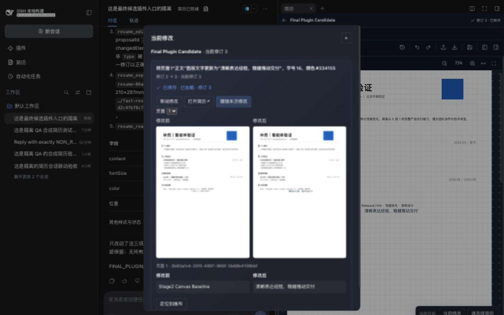

# Fast Resume for DeepSeek Harness

[English](README.md) | 中文

## 项目介绍

在 DeepSeek Harness 内完成简历创建、管理、编辑与智能体优化。通过多页画布自由调整文字、图片、形状和嵌套图层，从六套模板开始创作，并导出 PDF、PNG 或可继续编辑的 JSON。直接使用 Harness 已配置的模型提出措辞或排版修改，预览后应用到同一份简历。`dsh-fast-resume` 作为可选插件配置层安装，无需注册额外的 Fast Resume 账号。


## 目录

- [功能亮点](#features)
- [界面预览](#screenshots)
- [安装插件](#use-this-package)
- [使用方式与实例](#usage)
- [配置与存储](#configuration-and-storage)
- [开发与构建](#understand-the-implementation)
- [智能体交互](#model-experience)
- [使用边界与许可证](#known-limitations-and-deferred-work)

-----

<a id="features"></a>
## 功能亮点

将可视化编辑与智能体辅助放在同一个工作流中。

| 能力 | 可以做什么 |
|---|---|
| 多图层画布 | 编辑文字、图片和形状，组合嵌套图层，调整层级、可见性、锁定、对齐及元素属性。 |
| 模板与页面 | 从六套模板开始，管理多页简历、缩放画布，自由拖拽或收起左右侧栏。 |
| 简历管理 | 浏览真实首页缩略图，按名称搜索、排序、重命名、创建副本及删除简历。 |
| 版本历史 | 保存命名版本，预览历史页面，将选定版本恢复为新的当前修订。 |
| 智能体辅助 | 将当前简历和所选图层上下文带入普通 Harness 对话，预览、应用或撤销持久化修改提案。 |
| 导入与导出 | 导入 JSON、Markdown、Word 或 PDF；将全部页面导出为 PDF、当前页面导出为 PNG，或保存可编辑 JSON 备份。 |

-----

<a id="screenshots"></a>
## 界面预览

以下截图来自实际安装的 Harness Web 插件，使用验证流程中的合成简历展示功能。

### 简历画布

需要更大画布时可收起侧栏，也可通过右侧工具栏重新展开模板、图层和属性面板。拖拽越过最小阈值时，侧栏会自动收起。


### 可视化版本历史

通过真实保存页面的缩略图识别不同版本。选中版本后可切换预览页面，恢复时保留已有历史。


### 对话与改动审核

在 Harness 对话中并排查看改动前后页面与完整编辑器。此合成示例显示已应用的文字／样式修改，对话编辑器已确认修订 3 保存并加载。



-----

<a id="use-this-package"></a>
## 安装插件

需要 **DeepSeek Harness 0.2.1-rc.2**、Node **`^22.19.0 || >=24.0.0`**，并确保 PATH 中可用 pnpm。当前仓库中的插件版本为 `0.1.0`。

此集成候选版本尚未获准发布。安装包与浏览器模块消费检查针对已发布的 `0.2.1-rc.2` 依赖；Session 回放与 Web 验证使用同版本的本地构建 Harness 产物。这些结果不能证明已发布的 Harness 版本支持所有交互。本地集成验收覆盖已测试产物和声明的浏览器用例；发布仍需要支持相关功能且经过验证的 Harness 发行产物，以及明确批准。

获取已构建的 `.tgz` 安装包，或按[源码构建步骤](#understand-the-implementation)生成安装包，然后安装到实际使用的配置：

```sh
dsh plugin --profile web add /absolute/path/dsh-fast-resume-0.1.0.tgz
dsh --profile web
```

在 Harness 侧栏打开**简历**，即可看到已保存的简历以及新建、导入入口。

如果所用 npm 仓库已发布 `dsh-fast-resume@0.1.0`，也可以直接通过包名安装：

```sh
dsh plugin --profile web add dsh-fast-resume@0.1.0
```

对于已初始化的桌面配置，可将 `web` 替换为 `desktop` 并重启应用。已有浏览器验收覆盖 Web，未声称完成桌面交互验证。

-----

<a id="usage"></a>
## 使用方式与实例

### 1. 创建与编辑简历

1. 点击**新建简历**，输入名称，通过缩略预览选择模板或空白文档。已保存的简历可点击名称或**进入编辑**打开。
2. 在左侧面板切换模板、查看图层和管理页面；选中元素后，在属性面板调整文字、尺寸、颜色或链接。
3. 拖拽分隔条调整工作区宽度，通过工具栏面板图标收起或展开侧栏；当前工作区会记住展开宽度。
4. 等待状态显示已保存，或点击保存图标、使用 `Ctrl+S`。

编辑器进入后，默认按中间画布宽度尽量放大简历，长页面可纵向滚动。工具栏缩放保持视口中心，滚轮缩放保持鼠标位置；放大超过画布宽度后可横向滚动。“适应宽度”和“适应窗口”可分别恢复自动宽度适配和整页适配，手动缩放不会被面板调整覆盖。

### 2. 让 Harness 智能体辅助优化

从编辑器状态栏、视图菜单或 `Ctrl/Cmd+J` 打开 **Harness 助手**。全局编辑器会保存简历和完整编辑检查点，解析当前选择或默认工作区，并按已配置的默认模型策略创建一个普通 Harness 对话，并将完整编辑器转移到其右侧面板。中间输入框等待你的指令，入口不会自动发送提示词。在对话中使用这些入口只会显示该对话选定的简历，不会创建另一个对话。返回全局简历空间可明确开始新对话，继续旧对话则使用 Harness 对话列表。

普通对话中新出现的简历上下文或成功编辑活动可以打开其选定简历，不改变 Session 或模型。历史、重连和后台完成保持被动。关闭或选择其他资源会抑制本轮后续自动打开；旧结果不能覆盖更新的成功目标选择。低于 768px 时，请显式点击**打开简历**。**已保存 · 等待视图**表示持久化结果；**已保存 · 已加载**要求可见编辑器在渲染后确认该确切的干净修订。确认当前已保存修订后，会在渲染完成时重新报告该修订已加载。视图错误保留已保存状态和显式查看入口。

打开简历工具卡片的**当前修改**，再点击**审阅修改**，对比不可变的修改前后页面与内容。**应用建议**明确批准尚未修改文档的建议；**撤销本次修改**只撤销一个已应用批次，保留之后不相关的编辑。发生重叠时保留当前文档并显示冲突。编辑器的紧凑**当前修改**控件提供相同的审阅和撤销操作。结果未知时，**核对操作结果**继续使用原操作；重新加载会核对持久化的应用与撤销回执。较新的持久撤销回执优先于保留的应用回执；历史保存修订与当前已加载修订分别显示。

在对话编辑器或缺失目标的卡片中使用**请选择简历**。**对比查看**打开文档但不更换对话目标；**用于编辑**明确选定目标。编辑器标注对比视图，已确认的手动保存、导入与草稿副本会选择其编辑目标。**简历空间**仍打开全局列表。新修改在加载确认后显示局部 1.2 秒轮廓，历史卡片不会自动动画或导航。**定位到画布**明确导航到仍存在的已修改元素或页面；删除内容保留在对比预览中。

示例：在保留事实的前提下优化表述。

> 请读取当前简历，面向前端工程师岗位优化工作经历的表述。 保留已有事实、日期和数据，不要虚构成果或技能。 先生成修改提案，待我预览确认后再应用。

在对话中审阅建议后，再让助手应用需要的修改。`resume_propose` 不会修改简历。应用或撤销提案会检查修订及重叠修改，冲突时保留当前文档。

### 3. 保存阶段版本与对比历史

点击版本历史图标，输入“前端岗位投递版”等名称并保存命名版本。选中缩略图即可查看该快照，多页简历可切换预览页面。当前草稿保存后才能恢复历史；恢复会创建新修订并保留已有版本。

### 4. 导入与导出文档

通过**导入**打开已有 JSON 备份、Markdown、Word 或 PDF。导出 PDF 可保留全部页面，PNG 导出当前页面，JSON 用于可继续编辑的备份。PDF/Word 导入提取语义内容，不保证复刻原版式；PDF/PNG 导出需要连接的 Harness 客户端渲染器。

可将文件拖放到导入区，也可粘贴 Markdown 文本。读取文件和导入期间弹窗保持打开，校验或导入失败会直接在弹窗内提示。

-----

<a id="configuration-and-storage"></a>
## 配置与存储

简历、历史、提案和导出文件保存在当前配置目录内，默认位置为 `<profile>/data/fast-resume`。自动保存会检查修订；其他客户端或智能体修改同一简历时，未保存草稿会被保留，并提供重新加载及另存副本选项。恢复草稿需要明确选择。

<details>
<summary>高级配置</summary>

安装的[补丁](cordis.patch.yml)添加 `fast-resume` 和 `fast-resume-tools`。可在配置目录的 `cordis.patch.yml` 中覆盖 Host 配置行：

```yaml
- id: fast-resume
  config:
    autosaveDelayMs: 2000
    renderPixelRatio: 2
```

| 字段 | 默认值 | 含义 |
|---|---|---|
| `wheelZoomDirection` | `auto` | Ctrl/⌘ + 滚轮缩放方向：`auto` 根据浏览器设备反转标记校正，`standard` 按原始滚动增量处理，`reversed` 用于实际体验反向的设备。不按修饰键时仍正常滚动画布。显式反向也会反转以 Ctrl+wheel 传递的触控板捏合；触控板原生捏合应使用 `auto`。 |
| `storageDir` | `<profile>/data/fast-resume` | 原子文档封套、历史、提案、回执和导出文件 |
| `autosaveDelayMs` | `2000` | 浏览器保存防抖间隔 |
| `maxDocumentBytes` / `maxImportBytes` | 各 `10485760` | 文档及渲染响应、导入文件的字节上限 |
| `maxAssistantCheckpointBytes` | `67108864` | 规范化 UTF-8 编辑器检查点上限，包含撤销/重做历史和剪贴板 |
| `maxVersions` | `100` | 保留的文档版本数 |
| `renderTimeoutMs` / `rendererLeaseMs` | `30000` / `15000` | 渲染截止时间与可续期客户端租约 |
| `maxRenderRequests` / `maxRenderPixels` | `8` / `32000000` | 等待渲染的请求数及解码后的 PNG 像素上限 |
| `renderPixelRatio` | `2` | PNG 栅格倍率，允许范围 `0.1`–`4` |
| `editorPrepareTimeoutMs` / `editorLeaseMs` / `editorPollIntervalMs` | `15000` / `15000` / `1000` | 草稿准备期限、编辑器存活期限及轮询间隔；轮询必须短于租约 |
| `lockWaitMs` / `maxProposalOperations` | `10000` / `256` | 跨进程锁等待及每个提案的操作上限 |
| `frameConnectTimeoutMs` / `rendererPollIntervalMs` | `15000` / `1000` | 编辑器连接期限及后台渲染轮询；轮询必须短于租约 |
| `refreshIntervalMs` / `bridgeTimeoutMs` | `2000` / 渲染期限加连接期限 | 文档刷新及消息请求期限；消息期限不得短于导出期限 |

</details>

卸载插件：

```sh
dsh plugin --profile web remove dsh-fast-resume
```

卸载后保留配置目录内的简历和导出文件，重新安装到同一配置即可继续使用。

-----

<a id="understand-the-implementation"></a>
## 开发与构建

源码项目可以脱离原 Fast Resume 和 Harness 项目目录独立构建。在插件项目根目录执行：

```sh
npm ci --workspaces=false
npm run build --workspaces=false
npm pack --workspaces=false --ignore-scripts
```

构建得到 `dsh-fast-resume-0.1.0.tgz`。发布前应通过 `dsh plugin` 测试实际安装包；包内包含 Host、工具、Client、编辑器 HTML、安装补丁及文档。

安装验收使用真实的临时 tarball 安装，不使用源码别名。将 `DSH_TEST_CLI` 设为已构建的公开入口 `apps/cli/lib/bin.js`，将 `DSH_TEST_REPLAY` 设为同一已验证 Harness 构建中的 `packages/test-support/llm-replay/lib/index.js`，然后运行：

```sh
npm test --workspaces=false
npm run build --workspaces=false
node scripts/check-consumer.mjs
npm run check:release --workspaces=false
npm pack --workspaces=false --ignore-scripts
npm run test:e2e --workspaces=false -- ./dsh-fast-resume-0.1.0.tgz
npm run test:snapshot --workspaces=false -- ./dsh-fast-resume-0.1.0.tgz
```

脚本检查覆盖安装、卸载重装后的数据保留、工具禁用、两种已播种入口上下文以及选择性撤销。快照检查保留图片字节脱敏读取，并回放整理后的真实模型回合。回放保留实际 Session 标识与绑定，但从临时 headless 初始化中移除 Web Preset，因为 headless 无法组合该 Preset。这验证的是已安装工具的行为，不是完整 Web Session 的续接。两项检查均不请求模型提供商，也不替代浏览器验证。子进程退出后会删除临时配置；设置 `DSH_TEST_KEEP=1` 可保留本地证据。缺少入口路径会使检查失败。

详细业务结果、回放适配及未执行检查记录在 AI 助手验收报告（[English](docs/assistant-acceptance.md) / [中文](docs/assistant-acceptance.zh.md)）中。

### 本地 Harness 联调

确保 Node 和 pnpm 在 PATH 中，`npm run dev:setup --workspaces=false` 会构建并检查两个编译面，通过 `dsh plugin` 将 `link:` 依赖安装到 `.dev/home/profiles/web`。在 Harness 工作区内，先执行 `pnpm run build:artifacts` 构建 Harness；辅助脚本会使用 `apps/cli/lib/bin.js`。在其他目录中，它使用 PATH 上的 `dsh`，也可以通过 `DSH_DEV_CLI` 指定启动器文件。

```sh
npm run dev:setup --workspaces=false
npm run dev --workspaces=false
```

打开 Harness 在终端打印的带认证信息的地址（默认端口 `58358`），进入简历空间。辅助脚本监听源码、上游代码、语言资源及构建配置，重新构建前停止 Web，两个编译面均通过后重启。构建失败时 Web 保持停止，修复并保存源码后会重新构建。修改代码前请保存编辑器内容；中断的草稿使用正常的恢复流程。Ctrl+C 停止监听器及其子进程。仅构建并启动、不监听时使用 `npm run dev:start --workspaces=false`；Web 参数放在 `--` 后，例如 `npm run dev --workspaces=false -- --port 58359`。

`.dev/` 已被 Git 忽略，用于保存开发 profile、简历及本地配置。测试智能体辅助功能时，在这个开发 Web 界面配置模型；脚本不会复制其他 profile 的凭据。可显式设置 `DSH_HOME` 使用其他目录。全新克隆 Harness 后，执行 `git submodule update --init --recursive plugins/fast-resume` 初始化此目录。插件改动在此目录内提交并推送，再在 Harness 中暂存更新后的子模块版本。

<details>
<summary>实现概览</summary>

[安装补丁](cordis.patch.yml)添加 `fast-resume` 与 `fast-resume-tools`。Host 负责修订、原子文件写入、持久化提案及修改回执。编辑器在不透明来源 iframe 内运行，通过校验后的 MessagePort 通信，不持有模型凭据，也不调用原 Fast Resume 服务端。保留的上游源码及其哈希记录在 [upstream-content.json](upstream-content.json)。

</details>

-----

<a id="model-experience"></a>
## 智能体交互

简历工具在普通 Agent 作用域执行，请求和结果保留在 Harness Session 日志中。智能体可以读取当前文档、提出修改、应用或撤销提案、检查历史并导出制品。读取图片使用资源引用，导出结果包含制品路径与元数据，而非内嵌 base64 数据。

`resume_context` 解析调用方 Session 的目标，或使用最近读取的文档修订及唯一请求 ID 显式选择文档。比较读取不改变选择。目标缺失或已删除时必须重新选择；现有文档的 `sessionId` 字段不会建立绑定。相同选择请求的重试返回原结果，不覆盖后续选择；相同请求 ID 搭配不同输入会失败。选择不会改变文档 JSON、修订或历史。

`resume_edit` 将经过验证的一批操作、一个新修订、已应用提案及撤销回执写入同一个原子文档文件。返回 `{ schemaVersion: 1, resumeId, sessionId, baseRevision, receipt, summary }`。完全相同的重试先恢复原回执，再考虑编辑器是否在线；同一请求 ID 的不同输入会被拒绝。`resume_propose` 仍不修改文档。模型发起的 apply/revert/restore 同样准备编辑器，保留原有回执输出。模型提交后在文档锁之外关联当前 Session；关联失败会明确报告已提交的回执，不声称回滚。

经过身份验证的 UI 应用与撤销使用 `uiMutation`，复用模型修改的编辑器准备、Session 串行执行和回执恢复。结果分别报告已提交回执、目标关联（`bound`、`superseded`、`ambiguous`、`failed`）及编辑器释放（`released`、`uncertain`；恢复回执为 `not-required`）。`ResumeActions` 在传输结果未知时保留原请求，阻止非当前 Session 发起修改，并在 Remote 卸载前等待已取消操作结束。对话编辑器保存通过 `saveInSession` 使用当前编辑器能力和独立的 `contextSessionId`；保存前捕获选择顺序，保存后仅在该选择仍为当前选择时关联。关联失败仍返回已保存快照，并通过 `EditorApi.association()` 与保存错误分别提供。全局保存和对比读取不改变目标关联。

Host 对已接受的会话保存、上下文／交接请求、编辑器所有权请求以及模型／UI 修改负责，直到最终结果和持久化关联完成。提供者卸载或所属上下文销毁时拒绝新请求、取消尚未准入的模型准备，再等待已接受的写入和完成回调结束。等待期间仍可轮询、确认准备状态和持久化断开状态；全部结束后这三类调用也会拒绝。清理失败须在其他清理所有者和已接受操作结束后才报告。手动草稿保存仍不获取模型 Session 执行锁。

模型生成时，全局编辑器仍可编辑。提交前，编辑器暂停新手势，等待保存及本地恢复写入完成，刷新保存并确认干净修订。如果刷新改变模型读取的修订，AI 修改会被拒绝，需要重新读取并使用新的请求 ID。未知、离线、租约过期、Host 重启及待恢复状态仅阻止该文档的 AI 写入。打开文档并明确确认显示的已保存修订即可协调所有权；恢复副本保留，手动恢复仍可用。确认操作先等待尚未完成的轮询失败处理结束，再清除所有权不确定状态。启动时仅所有权拒绝提供显式恢复；文档缺失及读取失败提供本地化重试提示和返回简历空间的操作。

连续的助手提交修订作为一个手动撤销条目载入，清空重做并保留仍然存在的元素选区。重复确认不会增加历史或触发自动保存。文本输入、输入法组合及指针手势进行期间，外部更新会等待，不会中断当前编辑。如有本地草稿、修订间隔或缺失的修改回执，当前文档与历史将保留，并提供加载已保存修订或另存为副本的操作。

显式编辑器交接使用 `src/client/editor-handoff.ts` 中的 `prepareEditorHandoff`、`completeEditorHandoff` 和 `rollbackEditorHandoff`。调用方预先分配目标实例身份，将身份和 `EditorLaunch` 传给 `connectFrame`。准备完成后，`releaseEditorHandoff` 返回可序列化描述符，应先记入日志，再销毁源视图并导航。完成交接无需源虚拟机。源已关闭时，失败通过 `EditorHandoffRecoveryError.handoff` 返回恢复信息；`recoverEditorHandoff` 持久撤销旧目标，并用保留的同一份历史指定新的恢复实例。恢复结果未知时，使用同一新身份重试，再挂载并完成该实例。启动参数单独携带真实的可选 Session 上下文，不改变文档关联。准备操作等待保存和恢复写入完成、阻止新手势，并捕获完整历史及真实画布滚动位置和中心锚点。输入法组合和进行中的指针手势直接拒绝，不会被打断。目标恢复精确修订并确认已提交的布局后才可写入。手动缩放保持文档中心和横向溢出；宽度/整页适配按目标画布重新计算。显式检查点恢复会取消普通缩放已排队的锚点回调，防止加载确认后再次移动视口。检查点保留原始面板偏好。对话位置只折叠目标 iframe 内的面板，工具、面板标签、尺寸、历史、选区和手动缩放保持不变。持久检查点仍可用于全局恢复。全屏使用同一个标签页内容实例。

`editorTransferRead` 通过已认证的 Remote 按精确简历、交接及检查点 ID 进行只读查询，仅返回状态与修订。确认交接已激活且标签页存储可用、没有保留日志时，该交接已被消费；匹配日志对应已激活的交接且保存修订超过检查点时，该日志已过时。清理前会检查日志代次未变。传入描述符在持久写入日志或确认已消费前始终可供重试。已激活但修订相同的日志仍可能对应丢失的激活响应，必须显式恢复；待处理、未知、读取失败及更新的日志保持受保护。完成交接或确认已消费后，仅通过公共标签操作移除匹配的传入导航参数，保留当前 iframe 和历史。重新打开随后使用当前文档的普通所有权获取流程，需要时仍须显式恢复所有权。

Session 顶栏的**打开简历**操作通过已认证且不改变关联的 `readContext` API 解析当前 Session 的目标。提交后的 effect 再次检查挂载的 Session，然后打开 `dsh-resource://fast-resume/document/<id>`。公共右侧标签注册表在隐藏、切换 Session 和全屏时保留完整编辑器。已挂载的隐藏视图继续续租现有所有权，同时暂停画布刷新、模型修改准备及 CSS 动画；隐藏的布局不能确认检查点。返回简历库会打开全局页面，导入和副本通过公共标签导航替换资源地址。`sessionStorage` 日志在同一浏览器标签页的刷新之间保留交接描述符和恢复实例身份；重试会显式恢复失败且源已关闭的目标。每次日志写入携带新的代次，延迟操作只能替换或删除其持有的精确记录。标签页存储被拒绝时，普通编辑器仍可启动并显示临时所有者提示，但交接必须在关闭源视图前确认日志写入。清除浏览器标签页存储会删除此发现描述符，但 Host 检查点及恢复副本仍会保留。

每份文档通过一个私有 `storageDir/transfers-v1/<resumeId>.json` 记录保留恢复检查点。版本一存储源所有者/令牌/实例、指定目标所有者/实例/令牌、交接和检查点 ID、修订、检查点 JSON、回滚令牌、可选 `recoveryTarget` 标记及阶段（`prepared`、`claimed`、`active`、`revoking`、`rolledback`）。恢复记录与所有权记录分别原子写入，按准入锁、文档锁顺序执行，不构成多文件事务。未完成记录阻止浏览器写入和模型准入，拒绝替换及重复认领，绝不静默淘汰。已完成记录仅允许经验证的当前所有者替换。回滚先撤销目标，再为保留的源实例发放新令牌；响应丢失不代表目标不存在。后续交接在替换已完成记录前失败时，回滚在同一组锁下重新确认未改变的源令牌和实例；所有权不确定或存在其他未完成交接时仍会拒绝。不带令牌的外部 CAS 仍受支持；修订变化会显式拒绝恢复/回滚并保留历史。ResumeEnvelope、ChangeReceipt、Session 上下文及 Harness Session 格式均保持不变。

编辑器所有权独立存储于 `storageDir/owners-v1/<resumeId>.json`。版本一字段为 `schemaVersion`、`hostId`、`resumeId`、`ownerId`、`incarnationId`、`token`、`uncertain`、`seenAt`、可选的 `detached` 销毁证据、永久退役的 `retired` 实例，以及可选 `preparation`（`id`、`expectedRevision`、`deadline`、`phase` 和可选确认 `revision`）。所有权及文档各自原子替换，不是双文件事务。准入锁串行化准备、提交及所有者替换；替换先取准入锁再取文档写锁。轮询、确认及保存只取文档锁，令牌在该锁内紧邻修改进行验证。Session 关联使用上下文锁再取文档锁，位于模型提交锁之外。损坏记录明确失败，租约不清除不确定状态。不同 Host 实例须明确重新确认已有所有权。独立浏览器获取所有权不会替换已有写入者。显式恢复拒绝最近仍活跃的实例；对于已销毁、过期或已重启的所有者，恢复会撤销旧令牌，但在确认已保存修订之前仍保持不确定。过期本身不会授予所有权。只有明确销毁页面才设置 `detached`，运行中准备失败不会设置它。

当前打包编辑器的修改均携带文档品牌令牌；已撤销令牌及退役页面的延迟写入被拒绝。省略可选令牌的外部手动调用保留乐观 CAS 语义。未发现的旧版或其他设备草稿无法完整观察。`ResumeEnvelope.schemaVersion = 1`、已有 `ChangeReceipt` 字段及 Harness Session 格式不变；旧插件忽略所有权目录，不提供这些草稿协调保证。

待完成的模型关联使用每个 Session 至多一条 `storageDir/context-commits-v1/<sha256(SessionId)>.json` 记录，独立于已有 `contexts-v1` 记录。版本一意图字段为 `schemaVersion`、`sessionId`、`resumeId`、稳定哈希修改标识 `requestId`、完整输入 `fingerprint` 和 `previousBinding`（先前持久选择的请求 ID，或 null）。每个 Session 的执行锁使用 `lockWaitMs`，覆盖修改结果及意图处理；短上下文操作和文档锁在执行所有权内依次取得，不从已持有的文档锁中取得这些锁。关联修复依据选择身份而非时间戳，允许文档修订继续增加。之后的显式选择优先于修复。不同的未决意图会被拒绝；相同重试在重启后仍可修复。已确认的提交前拒绝在验证无回执后只清理自己捕获的意图；未知存储结果保留意图。上下文写入与意图清理分别原子执行；已持久化的绑定回执使未完成清理可幂等重试。没有顺序证据的历史回执保留当前选择，并明确报告关联歧义。文档、`ChangeReceipt`、`ResumeSessionContextV1` 及 Harness Session 格式不变。

恢复写入错误与保存失败分别显示。AI 准备等待备份写入，并拒绝未解决的恢复错误；已确认的手动保存仍会成功并执行清理。成功的新备份或该确切草稿代次的持久保存会清除对应恢复错误。较早操作的完成不会清除更新备份或草稿的失败。

助手显式入口记录独立保存于 `storageDir/handoffs-v1/<requestId>.json`。版本一记录包含 `schemaVersion`、品牌类型 `requestId`、`resumeId`、`expectedRevision`、选定的 `workspaceId`、预分配的 `requestedSessionId` 及可选的真实 `sessionId`。工作区在准入前确定，重试不会改变；公共 Client Session 服务在该工作区创建并发布 Session。缺少工作区的记录保留原有证据，但重试不能完成入口或创建替代对话。`beginAssistantHandoff` 原子地准许一次创建，`recordAssistantSession` 在 `bindAssistantContext` 前保存实际响应身份，`readAssistantHandoff` 恢复确切证据。绑定不会写入旧 `ResumeEnvelope.sessionId` 或增加简历修订。已知绑定失败会重试同一 Session；创建结果未确认时，只核对日志和 Host 目录中完全匹配的请求身份。若服务端返回不同身份而响应丢失，结果仍为未知，不会再次创建，请检查 Harness 对话列表。编辑器挂载失败会保留 Session、绑定和检查点，供显式重试。

Client 在准备前将活跃请求身份保存于 `sessionStorage['fast-resume:assistant-entry:v1:<resumeId>']`。三个入口共用一个等待保护。保存或日志失败不会创建 Session；导航前失败会尝试经确认的源编辑器回滚。即使源视图在创建期间关闭，也会保存已知的真实响应。准备完成后立即通过 `EditorViews.retain` 保留独立描述符，再等待创建或绑定；只有匹配的回滚确认才允许按代次清理。导航后，无可见内容的公共 `shell.overlay` effect 观察右侧栏已提交挂载的 Session，再打开确切资源；空白 Session 不渲染标题动作。Harness 显示顶栏动作时，显式打开入口仍然可用。再次显示同一资源而不提供启动参数时，已有 iframe 和历史保持不变。若源视图关闭，请在全局空间重新打开该份简历，注册被拒绝后选择**恢复编辑器**。父页面使用显式全局启动信息、保留的描述符及新指定的恢复实例重新连接同一 iframe，在启用保存前还原原始检查点；普通浏览不会推断最近文档或获取其未完成所有权。全局恢复保留未完成的助手请求，只有其真实对话内的目标激活成功后才清理匹配的标签页入口，包括重新加载后的恢复。清空标签页存储会失去入口发现指针，但不会删除 Host 记录，也不能证明创建失败。

Session 目标持久化于 `storageDir/contexts-v1/<sha256(SessionId)>.json`。每条版本一记录包含 `schemaVersion`、类型化的 `ResumeSessionContextV1` 上下文及绑定回执（`requestId`、输入指纹、上下文、已确认的文档修订）。上下文包含真实 Session ID、简历 ID、UTC 更新时间及来源（`editor-entry`、`explicit-tool` 或 `committed-edit`）。写入方持有 Session 和文档锁，原子替换单条记录。读取方显式拒绝无效版本、字段或 Session 身份，不猜测其他目标。此插件自有格式独立于版本一 `ResumeEnvelope` 和 Harness Session 事件；旧文档保持不变，不具备此功能的版本忽略独立目录。全局手动编辑器工作流无需绑定。


-----

<a id="known-limitations-and-deferred-work"></a>
## 使用边界与许可证

- 原编辑器标签目前为中文，Harness 集成外层支持中英双语。
- 智能体辅助使用 Harness 中的模型配置；应用到简历前请预览修改提案。
- 远程图片可能加载失败或阻止画布导出，插件会明确报告此类失败。
- Fast Resume 保留 **PolyForm Noncommercial 1.0.0** 许可证。商业使用需要上游所有者另行书面许可，详见 [LICENSE](LICENSE)、[NOTICE](NOTICE) 和[商业许可条款](COMMERCIAL_LICENSE.md)。

已执行检查及平台覆盖范围见[验证报告（English）](docs/verification.md)（[中文](docs/verification.zh.md)）。源码与问题反馈：[lianzxah/dsh-fast-resume](https://github.com/lianzxah/dsh-fast-resume)。

<a id="dev-note"></a>
### 开发备注

<details>
<summary>维护说明</summary>

截图使用合成简历；使用流程变化时，同步更新两种语言的文档。

</details>
